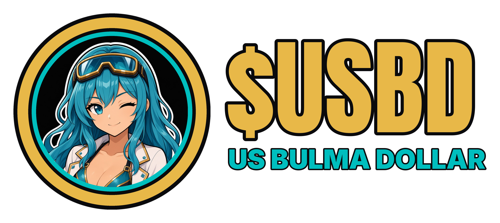

**Read this on the dark page:** https://d4trhban3.github.io/d4rth-launch-protocol/BULMA-USBD-READY-TO-LAUNCH/README.html

**This folder is the example coin.** I liked the sound of Bulma Dollar. I'd be happy if you launched it. Just as happy if the coin is yours. If you use this one, the ticker is $USBD.

# Bulma Dollar

*The example coin. Built with the [d4rth Launch Protocol](../LAUNCH-ANY-COIN-TEMPLATE.md).*

**Name:** $USBD Ultimate Super Bulma Dragonballs  
**Concept:** the Bulma dollar. The example hub for the Big Titty Coin group. Same six steps as any other coin.

## Launch sequence (do it in this order)
Full details in [HOW-TO-LAUNCH-USBD.md](HOW-TO-LAUNCH-USBD.md).

1. **Launch the coin on pump.fun, paired with USDC. That is the main pool.** USDC is a dollar on Solana.
2. **Buy about 20% of the coins yourself.** 200M tokens. That leaves most of the rest for other people.
3. **Lock 10% in a pool with BTC on Meteora.** BTC is the main coin of this group. Lock means the money cannot be pulled back out.
4. **Lock 10% in a pool with SOL on Meteora.** Same thing, with Solana's own coin.
5. **Leave the rest in the USDC pool.** That stays the main pool, during the launch and after.
6. **Then other coins lock a piece of their supply against this coin.** It becomes the hub they all connect through.  
   For this group, that means a piece from every coin, locked on Meteora against Bulma. Same process if the hub is a different coin.

Here's the whole package: art, logo, steps, posts, lore — all done.

**From me:** I designed this on purpose to supercharge the Big Titty ecosystem. I don't have the liquidity to launch it myself. If you launch it, throwing me some creator fees would be dope (GitHub `d4trhban3` as a pump.fun fee recipient). Strongly encouraged, not required. Nothing breaks without it. Only works if creator fees stay on. See [Support the protocol](../README.md).

Launch post: [ANNOUNCEMENT-POSTS.md](../ANNOUNCEMENT-POSTS.md) · Use it for any token: [LAUNCH-ANY-COIN-TEMPLATE.md](../LAUNCH-ANY-COIN-TEMPLATE.md)

Posts: [USBD-POSTS.md](USBD-POSTS.md) · Art pack: [USBD-ART/README.md](USBD-ART/README.md) · Lore: [USBD-LORE.md](USBD-LORE.md)

Fan parody. Not a stablecoin, not pegged, not affiliated with any anime studio. Concept and build by @d4rthban3.
