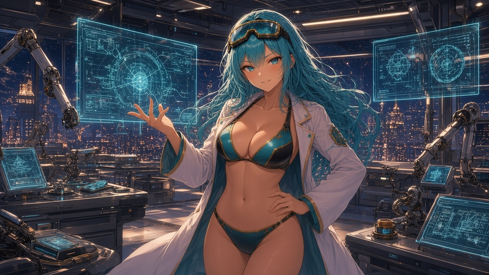
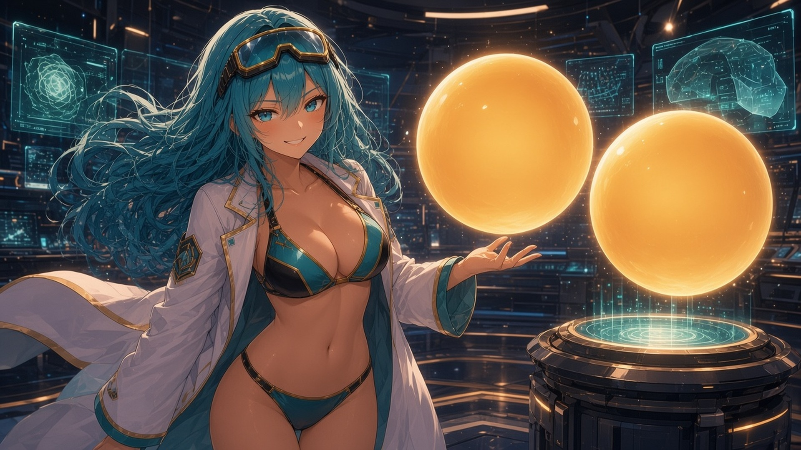
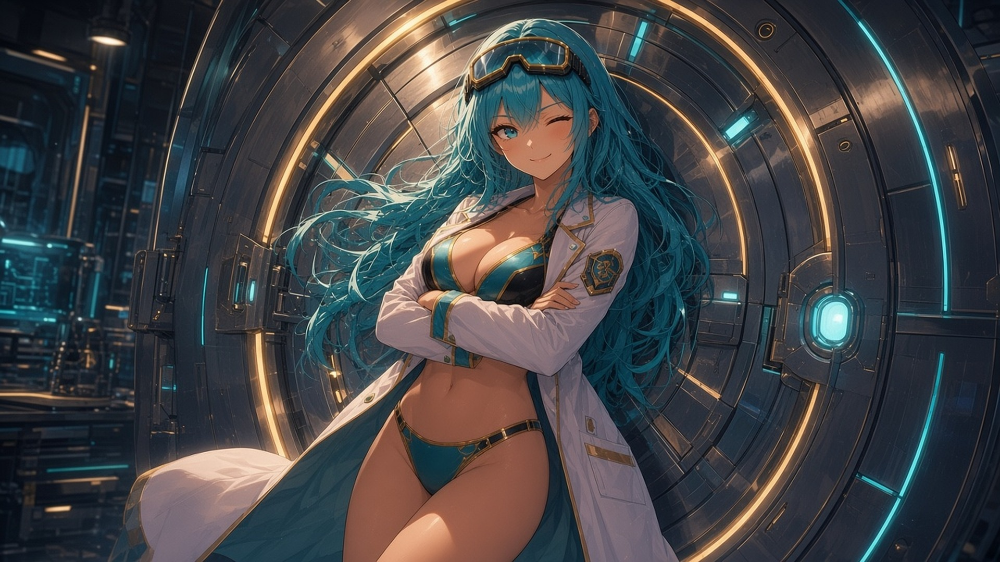
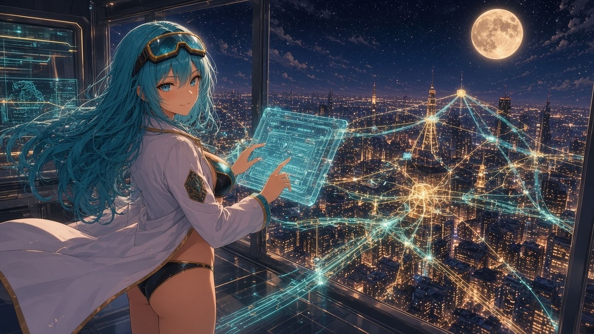
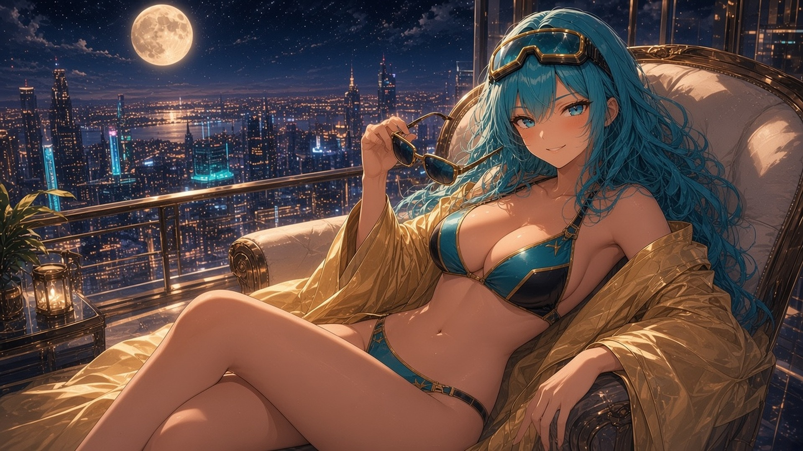

# $USBD · Ultimate Super Bulma Dragonballs
## The Gospel of Bulma Labs

> **Lore in one breath:** Bulma is the richest girl in anime and the smartest person in any room, and she got so bored of infinite money that she engineered a better one. $USBD Ultimate Super Bulma Dragonballs is the Bulma dollar — the Big Titty Coin eco's dollar: two-thirds real USDC in her vault, one-third locked forever with her best friend, the Big Titty Coin girl. She pays her holders, routes every coin through her lab, and the sell button is still in R&D.

## 1. Origin: The Heiress Who Got Bored
Bulma was born rich. Not "nice car" rich, but "owns the skyline and the moon has a parking spot" rich. By age twelve she'd bought everything there was to buy, and by thirteen she'd started inventing things to buy.

Then one night at Bulma Labs, staring at a mountain of money that did literally nothing, she had the thought that ruins economists: *"This could be better engineered."*

So she rebuilt money. On a whiteboard. In a bikini. Before breakfast.

## 2. Why a Dollar
The Big Titty Coin eco was thriving: girls everywhere, bags everywhere. But every coin had the same problem. To get in or out you had to swim through five sketchy routes and a bridge held together by vibes.

Bulma looked at it and said "skill issue." Every coin needed a stable door in and out, so she built the door. She called it the **US Bulma Dollar**, because when the richest girl in anime prints a dollar, you name it after her.

## 3. The Vault: Why USDC
Genius doesn't run on vibes. **Two-thirds of her reserve is real USDC**, sitting in the vault under the tower, which is why USDC is her main pair. When you trade $USBD, you touch real dollars.

Other coins promise backing. Bulma *installed* it.

## 4. The Pact: Why $BTC

Every heiress needs exactly one equal, and Bulma found hers in the **Big Titty Coin girl**: orange hair, black jacket, laugh you can hear across the eco. They met at the top of the tower, clinked glasses, and agreed to stop competing and start compounding.

To seal it, Bulma did the most romantic thing a genius can do. She locked **one-third of her entire supply** into a pool with $BTC **and threw away the key**.

That's the core of her character: **Bulma never breaks a contract.** The liquidity is permanently locked. No pulling, no rugging, no "we're restructuring." It is a pact written in code, and the code doesn't have an undo button.

## 5. The Allowance: Holder Rewards
Bulma has had an allowance since birth, and now so do you. Trading fees flow back to **$USBD holders** as rewards.

Why would the richest girl in anime share? Because *genius doesn't hoard*. Hoarding is for people who think they'll never earn it again. Bulma knows she'll invent more by Tuesday.

## 6. The Router: The Hub
Bulma's dream isn't one coin. It's a *switchboard*.

Every token in the Big Titty Coin eco can pair with $USBD and get a dollar route through her lab. Holding a girl coin and want out? Through Bulma. Want in? Through Bulma. Want to hop between two girls? Believe it or not, through Bulma.

She is the eco's switchboard: every line connects, and every call goes through Bulma Labs.

## 7. The Inventions
- **The Lock:** her best invention, a vault door that can never open. *Mechanic:* permanently locked LP.
- **The Router:** a switchboard that connects every coin in the eco to a dollar. *Mechanic:* the hub pairs.
- **The Allowance:** a machine that pays her people while they sleep. *Mechanic:* holder rewards.
- **The Twin Spheres:** two perfectly round, perfectly engineered power cores, so classified they have no blueprint. Engineers who saw them just whisper *"Ultimate Super Bulma Dragonballs"* and stare at the wall. *Mechanic:* the meme line, and the vibes.
- **The Sell Button:** **still in R&D.** It's been in R&D since launch, and she refuses to ship it.

## 8. Running Gags
- **"Ultimate Super Bulma Dragonballs."** It's the slogan, it's the meme line, and it means exactly what you think.
- **The sell button is still in R&D.** Every update ships everything except that.
- **Nobody crosses Bulma.** Even the proudest prince in anime never pisses off Bulma. Neither do her holders. You don't dump on the girl who controls the switchboard.
- **Before breakfast.** Every impossible thing she builds, she builds before breakfast.

## 9. Canon (taglines)
1. The richest girl in anime prints the eco's dollar.
2. Real dollars in the vault. A pact with $BTC. Rewards for the people.
3. Genius doesn't hoard.
4. Bulma never breaks a contract.
5. Every coin routes through Bulma Labs.
6. The sell button is still in R&D.
7. Even the proudest prince never crosses Bulma.
8. Ultimate Super Bulma Dragonballs.

## 10. Closing
The rest of anime fights over power. Bulma just builds it, prices it, locks it and pays you for holding it.

**Welcome to Bulma Labs. Don't touch anything.**

---
*Fan parody. Not a stablecoin, not pegged, not affiliated with any anime studio. Lore by @d4rthban3.*
